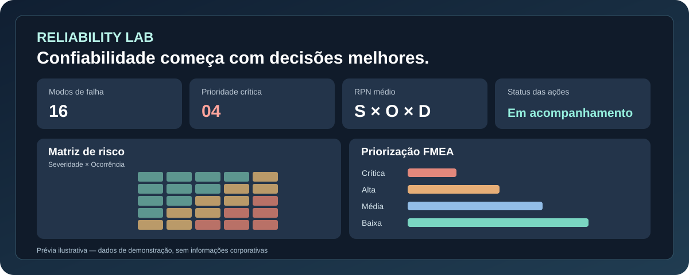

<p align="center">
  
</p>

# Reliability Lab · FMEA & Criticidade

**Laboratório interativo de confiabilidade e priorização de modos de falha — Versão 1.1**  
Desenvolvido por **Talita Souza** · Engenharia de Controle e Automação · PCM, dados e automação

**[Abrir a demonstração online ↗](https://talita-olv.github.io/reliability-lab/)**

[](./tests) [](./assets/app.mjs) [](LICENSE)



> **Atenção:** projeto demonstrativo independente, com dados inteiramente fictícios. As escalas e faixas de prioridade são ilustrativas. Não se trata de uma aplicação normativa certificada nem de uma ferramenta de decisão de segurança.


## O problema

Planilhas isoladas de modos de falha dificultam a visualização da exposição a riscos, a rastreabilidade das avaliações e a priorização de atividades. Este projeto demonstra como combinar **FMEA**, análise de dados e interface digital para organizar informações, **sem substituir revisão técnica**.

## O que a demonstração permite

- Explorar **16 exemplos fictícios** de falhas em sistemas mecânicos, elétricos, instrumentação e utilidades.
- Calcular automaticamente o **RPN = S × O × D** com escalas inteiras de 1 a 10.
- Aplicar regras **ilustrativas e explícitas** de prioridade e destacar severidades altas.
- Visualizar uma matriz **5 × 5** de severidade × ocorrência, em agrupamentos da escala original.
- Filtrar por prioridade, status e palavras-chave; ordenar por RPN, prazo e ativo.
- Incluir, editar e excluir registros apenas durante a sessão no navegador.
- Importar planilhas **Excel `.xlsx`** (seleção da aba com o cabeçalho esperado) ou **CSV** (`;` ou `,`) com validação, e exportar a seleção para CSV.
- Consultar **30 exemplos de atribuição de notas S/O/D**, de 1 a 10, diretamente na interface.
- Gerar **relatório de análise e plano de ação para salvar em PDF** através do diálogo de impressão do navegador, mantendo critérios e filtros visíveis.
- Executar **testes automatizados**, sem dependências externas de execução.

## Como executar

O sistema é composto por HTML, CSS e módulos JavaScript nativos. Por usar módulos ES, acesse-o por um servidor HTTP local (em vez de abrir `index.html` via `file://`).

```bash
# Com Python instalado, na pasta do repositório:
python3 -m http.server 8000
# Abra http://localhost:8000
```

Ou publique os arquivos diretamente no **GitHub Pages**. Não precisa de Node para abrir a interface; Node é usado só nos testes. Para importar XLSX, use navegador atual com suporte a `DecompressionStream('deflate-raw')`, como Chrome/Edge recentes. Se não houver suporte, utilize o CSV.

**Para pessoas sem experiência com sistemas:** acesse o [Guia de uso passo a passo](docs/GUIA_DO_USUARIO.md).

### Testes

```bash
npm test
```

**Requisitos para testes:** Node.js 20 ou superior. Não é necessário `npm install`.

## Como experimentar

1. Abra a página e explore os indicadores e o mapa de risco alimentados pela base fictícia.
2. Filtre os modos de falha por prioridade e status; experimente ordenações diferentes.
3. Clique em **Novo modo de falha** ou **Editar** e modifique um escore de S, O ou D para observar o recálculo.
4. Baixe o [modelo Excel](exemplos/fmea_modelo.xlsx) ou use o [modelo CSV](exemplos/fmea_demo.csv). Importe o arquivo para substituir a base fictícia durante a sessão. O importador lê apenas os valores; não executa macros nem fórmulas.
5. Clique em **Consultar exemplos para cada nota (1–10)** para ver ancoragens ilustrativas de severidade, ocorrência e detecção.
6. Clique em **Relatório PDF** para abrir a visualização do relatório; depois clique em **Imprimir / Salvar como PDF** e selecione **Salvar como PDF** como destino da impressão.
7. Exporte um CSV para conservar as alterações; nada fica salvo ao fechar.
8. Se quiser recomeçar, clique em **Restaurar exemplo**.

## Metodologia e limites

Leia [Metodologia, critérios e limites](docs/metodologia.md) antes de interpretar os resultados.

**Regras de prioridade de demonstração (não normativas):**

| Prioridade | Condição aplicada em sequência |
| --- | --- |
| Crítica | S ≥ 9 **ou** RPN ≥ 300 |
| Alta | S ≥ 7 **ou** RPN ≥ 180 |
| Média | RPN ≥ 80 |
| Baixa | Demais casos |

A matriz 5 × 5 é uma **visualização separada**, calculada a partir de S e O. Suas cores não substituem a prioridade FMEA, que também considera a detecção. Os limiares não representam recomendação de norma ou prática universal.

**Privacidade:** os arquivos CSV são processados localmente em memória no navegador. Não há conta, backend, cookies do aplicativo, armazenamento persistente ou telemetria própria. Não importe dados operacionais confidenciais em ambientes não aprovados pela sua organização. O PDF também é gerado localmente pela impressão do navegador: a aplicação abre uma janela de pré-visualização, não gera um download PDF silencioso. O provedor de hospedagem pode registrar acessos normais ao site.

**Atenção a diferenças de metodologia:** a abordagem é inspirada na lógica clássica de FMEA, não implementa integralmente IEC 60812, AIAG & VDA Action Priority, classificação SIL, LOPA, APR ou decisões sobre integridade de sistemas.

## Estrutura

```text
reliability-lab/
├── index.html                   # Interface
├── assets/
│   ├── styles.css               # Identidade visual responsiva
│   ├── logo-reliability-lab.webp # Marca completa (GitHub e documentação)
│   ├── logo-mark.webp            # Símbolo compacto e favicon
│   ├── app.mjs                  # Interação, filtros, importação e edição
│   ├── core.mjs                 # Regras e CSV testáveis
│   └── demo.mjs                 # Base fictícia
├── exemplos/fmea_demo.csv       # Modelo CSV
├── exemplos/fmea_modelo.xlsx     # Modelo Excel com orientações
├── docs/metodologia.md          # Critérios e limitações
├── docs/GUIA_DO_USUARIO.md      # Uso sem programação
├── docs/overview.svg           # Ilustração do painel demonstrativo
├── tests/core.test.mjs          # Testes automatizados
├── .github/workflows/tests.yml  # CI no GitHub Actions
├── .nojekyll                    # GitHub Pages
├── package.json
└── LICENSE
```

## Publicar no GitHub Pages

1. Crie um repositório público chamado `reliability-lab`.
2. Suba a estrutura completa deste projeto na branch `main`.
3. Em **Settings → Pages → Build and deployment**, selecione **Deploy from a branch**, `main` e `/ (root)`.
4. Após a publicação, o endereço padrão será `https://talita-olv.github.io/reliability-lab/` (o endereço só funcionará depois que o GitHub concluir o deploy).

## Possíveis evoluções

- Histórico versionado de avaliações (banco e autenticação), com trilha de auditoria.
- Plano de ação com responsáveis, revisões e evidências.
- Configuração transparente de matrizes e critérios por área de negócio.
- Modelos de dados para integração com BI e CMMS, respeitando autorizações e privacidade.

---

Criado por **[Talita Souza](https://github.com/talita-olv)** · [LinkedIn](https://www.linkedin.com/in/talita-souza-136590122/)
